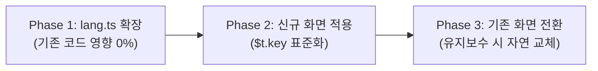

# 🌐 다국어(i18n) 언어팩 구조 점진적 리팩토링 계획서

> **문서 상태**: **Phase 1 적용 완료 (브랜치: `refactor/i18n-store`)**  
> **아키텍처**: `src/lib/locales/` 화면/도메인별 분할 + `src/lib/stores/lang.ts` 하위 호환 허브  
> **핵심 전략**: **100% 하위 호환성을 보장하는 무중단·점진적 개선 (Zero-Risk Incremental Migration)**

---

## 1. 추진 배경 및 개선 목적

### 1.1 현재 구조의 한계
현재 [src/lib/stores/lang.ts](file:///d:/0.%20projects/QR-scan-app/src/lib/stores/lang.ts)는 약 950줄의 단일 파일로, 상단(ko)과 하단(es)이 450줄 이상 떨어져 있습니다.
* **스페인어 누락 위험:** 한국어 키만 등록하고 스페인어를 빠뜨려도 빌드 타임에 에러가 나지 않아, 현장에서 스페인어 전환 시 `undefined`가 노출되는 런타임 위험이 있습니다.
* **호출부의 번거로움:** 컴포넌트마다 `import { lang, t }`로 두 개를 임포트하고, 템플릿마다 `t[$lang].login` 형태로 이중 인덱싱을 거쳐야 합니다.
* **도메인 혼재:** 공통 UI, 로그인, 점검, 동기화 등 300여 개 키가 단일 객체에 평면적으로 나열되어 있습니다.

### 1.2 개선 목표
1. **단어 등록 편의성 및 누락 차단:** 한/스페인어를 키 단위로 나란히 작성하게 하여 휴먼 에러를 원천 방지하고 TypeScript 컴파일러로 누락을 강제 검증.
2. **호출 코드 간소화:** `t[$lang].key` ➔ **`$t.key`** 형태로 Svelte 표준 반응형 스토어 단일 호출 지원.
3. **무위험 점진적 전환:** 기존 화면 코드를 일괄 변경(Big Bang)하지 않고, 기존 코드 100% 동작을 보장하면서 신규 화면부터 단계적으로 적용.

---

## 2. 아키텍처 설계 (Architecture Design)

### 2.1 사전 정의 방식: 키 단위 1:1 바인딩 (방안 B)
한국어와 스페인어를 하나의 블록 안에 나란히 정의하여 스페인어 작성을 강제합니다.

```typescript
// src/lib/stores/lang.ts
export type Lang = 'ko' | 'es';

// 단어 사전 정의
export const dictionary = {
  // [공통 UI]
  confirm: { ko: '확인', es: 'Aceptar' },
  cancel:  { ko: '취소', es: 'Cancelar' },
  back:    { ko: '뒤로 가기', es: 'Atrás' },

  // [로그인]
  login:      { ko: '로그인', es: 'Iniciar sesión' },
  inputError: { ko: 'ID와 비밀번호를 모두 입력해주세요.', es: 'Ingrese ID y contraseña.' },

  // [QR 스캐너]
  scannerTitle: { ko: 'QR 코드 스캐너', es: 'Escáner QR' },
  scannerStart: { ko: '점검 시작', es: 'Iniciar Inspección' }
} satisfies Record<string, Record<Lang, string>>;
// 👆 TypeScript가 단 하나의 키라도 es가 빠지면 컴파일 에러를 발생시킴
```

---

### 2.2 파생 스토어(derived) 도입 ➔ `$t.key` 실현
`lang` 스토어가 바뀔 때마다 현재 선택된 언어의 문자열만 추출하는 파생 스토어를 생성합니다.

```typescript
import { writable, derived } from 'svelte/store';

export const lang = writable<Lang>(initialLang);

// 신규 표준 반응형 스토어: 화면에서 $t.login 으로 접근
export const t = derived(lang, ($lang) => {
  const result: Record<string, string> = {};
  for (const [key, trans] of Object.entries(dictionary)) {
    result[key] = trans[$lang];
  }
  return result;
});
```

---

### 2.3 100% 하위 호환성 브리지 (Legacy Compatibility)
기존 화면들이 여전히 `t[$lang].login`을 호출하더라도 절대 깨지지 않도록 하위 호환 객체를 함께 제공합니다.

```typescript
// 기존 레거시 호출 t[$lang].key 를 100% 보장하는 호환 객체
export const legacyT = {
  get ko() {
    return Object.fromEntries(Object.entries(dictionary).map(([k, v]) => [k, v.ko]));
  },
  get es() {
    return Object.fromEntries(Object.entries(dictionary).map(([k, v]) => [k, v.es]));
  }
};
```

---

## 3. 화면별 사용 코드 비교 (Before vs After)

### 🔴 기존 방식 (Before)
```svelte
<script lang="ts">
  import { lang, t } from '$lib/stores/lang'; // 스토어 2개 임포트
</script>

<div>
  <!-- t[$lang] 이중 인덱싱 평가 필요 -->
  <h1>{t[$lang].scannerTitle}</h1>
  <button>{t[$lang].scannerStart}</button>
  <button>{t[$lang].back}</button>
</div>
```

### 🟢 개선 후 신규 방식 (After)
```svelte
<script lang="ts">
  import { t } from '$lib/stores/lang'; // t 스토어 1개만 임포트
</script>

<div>
  <!-- $t 로 직접 깔끔하게 접근 & 언어 변경 시 초고속 반응형 갱신 -->
  <h1>{$t.scannerTitle}</h1>
  <button>{$t.scannerStart}</button>
  <button>{$t.back}</button>
</div>
```

---

## 4. 점진적 개선 3단계 로드맵 (Roadmap)



| 단계 | 작업 내용 | 소요 시간 | 리스크 | 기존 코드 영향 |
| :--- | :--- | :---: | :---: | :---: |
| **Phase 1: 사전 구조 개편** | `lang.ts`에 `dictionary` 및 `$t` 파생 스토어 구축, 기존 `t` 호환 브리지 연결 | 약 1~2시간 | 없음 (0%) | 0% (기존 동작 완벽 유지) |
| **Phase 2: 신규 화면 표준 적용** | 향후 생성되는 신규 화면 작성 시 `$t.key` 권장 및 개발 가이드 동기화 | 일상 개발 | 없음 (0%) | 없음 |
| **Phase 3: 기존 화면 순차 전환** | 기존 컴포넌트 수정 작업 발생 시 해당 컴포넌트의 `t[$lang]` ➔ `$t` 치환 | 화면당 2~3분 | 매우 낮음 | 수정한 화면만 국소 반영 |

---

## 5. Phase 3 대상: 기존 화면 마이그레이션 우선순위

기존 화면은 급하게 수정할 필요 없이, 아래 순서대로 유지보수 티켓이 발생할 때 1화면씩 전환합니다:

1. **1순위 (공통 및 네비게이션):**
   - [src/lib/components/Header.svelte](file:///d:/0.%20projects/QR-scan-app/src/lib/components/Header.svelte)
   - [src/routes/+layout.svelte](file:///d:/0.%20projects/QR-scan-app/src/routes/+layout.svelte)
   - [src/lib/components/ConfirmModal.svelte](file:///d:/0.%20projects/QR-scan-app/src/lib/components/ConfirmModal.svelte)
2. **2순위 (주요 진입 화면):**
   - [src/lib/components/LoginScreen.svelte](file:///d:/0.%20projects/QR-scan-app/src/lib/components/LoginScreen.svelte)
   - [src/lib/components/DashboardScreen.svelte](file:///d:/0.%20projects/QR-scan-app/src/lib/components/DashboardScreen.svelte)
3. **3순위 (핵심 기능 화면):**
   - [src/routes/scanner/+page.svelte](file:///d:/0.%20projects/QR-scan-app/src/routes/scanner/+page.svelte)
   - [src/routes/maintenance/+page.svelte](file:///d:/0.%20projects/QR-scan-app/src/routes/maintenance/+page.svelte)
   - [src/routes/history/+page.svelte](file:///d:/0.%20projects/QR-scan-app/src/routes/history/+page.svelte)
4. **4순위 (기타 설정 및 유틸 화면):**
   - [src/routes/settings/+page.svelte](file:///d:/0.%20projects/QR-scan-app/src/routes/settings/+page.svelte)
   - [src/routes/users/+page.svelte](file:///d:/0.%20projects/QR-scan-app/src/routes/users/+page.svelte)
   - [src/routes/manual/+page.svelte](file:///d:/0.%20projects/QR-scan-app/src/routes/manual/+page.svelte)

---

## 6. 검증 계획 (Verification Plan)

1. **타입 안전성 검증 (`npm run check`):**
   - 사전에 키를 추가했을 때 `es`를 빠뜨리면 빌드 에러가 정상 발생하는지 확인
   - 기존 컴포넌트의 타입 오류 0건 유지 확인
2. **단말 런타임 언어 전환 테스트:**
   - 앱 우상단 프로필 메뉴 또는 환경설정에서 `KOR` ➔ `ESP` 토글 시 즉시 전체 UI 반응형 갱신 확인
   - 로컬 스토리지(`lang`, `app_settings`) 정상 저장 및 재기동 후 유지 확인
3. **오프라인 동작 검증:**
   - 비행기 탑승 모드(오프라인) 상태에서도 번역 로딩 지연/실패 없이 정상 노출 확인

---

## 7. 결론 및 향후 진행 가이드

* **현 상태 유지 권고:** 현재 운영 중인 배포 버전(`v1.2.7`)은 정상 동작 중이므로, 즉각적인 코드 수정보다는 **차기 버전 개발 주기 또는 신규 화면 대량 추가 시점에 Phase 1을 먼저 적용**하는 것을 권장합니다.
* 본 계획서는 향후 리팩토링 시 표준 지침서로 활용할 수 있도록 프로젝트 문서 체계에 영구 보존됩니다.
